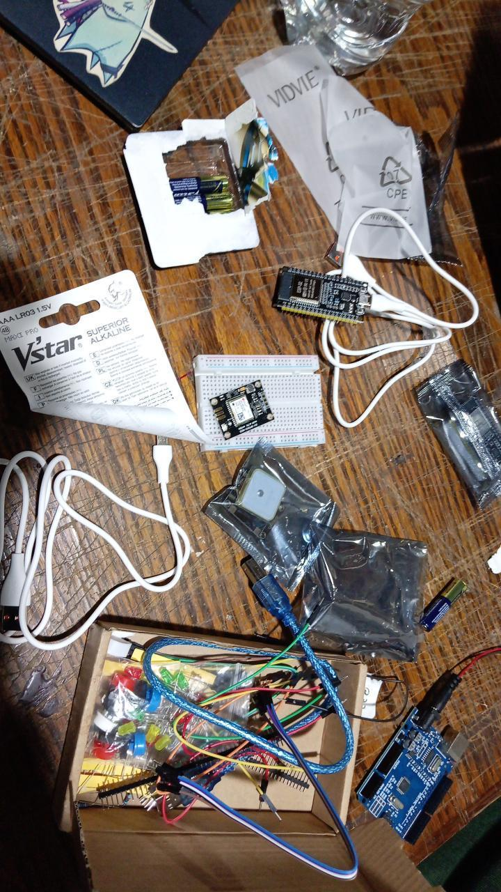
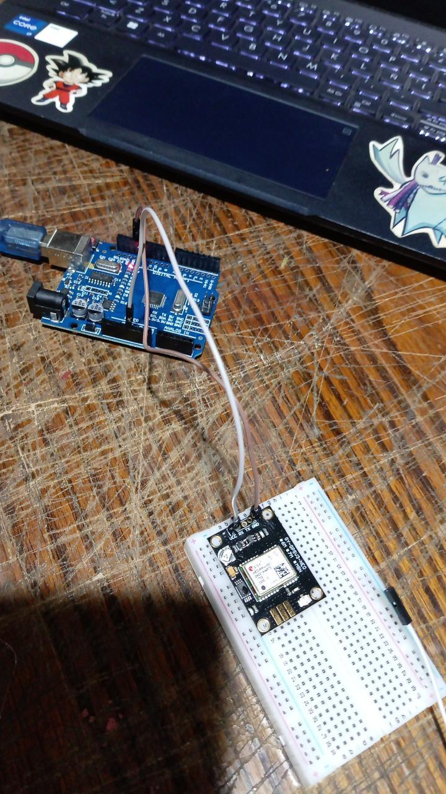
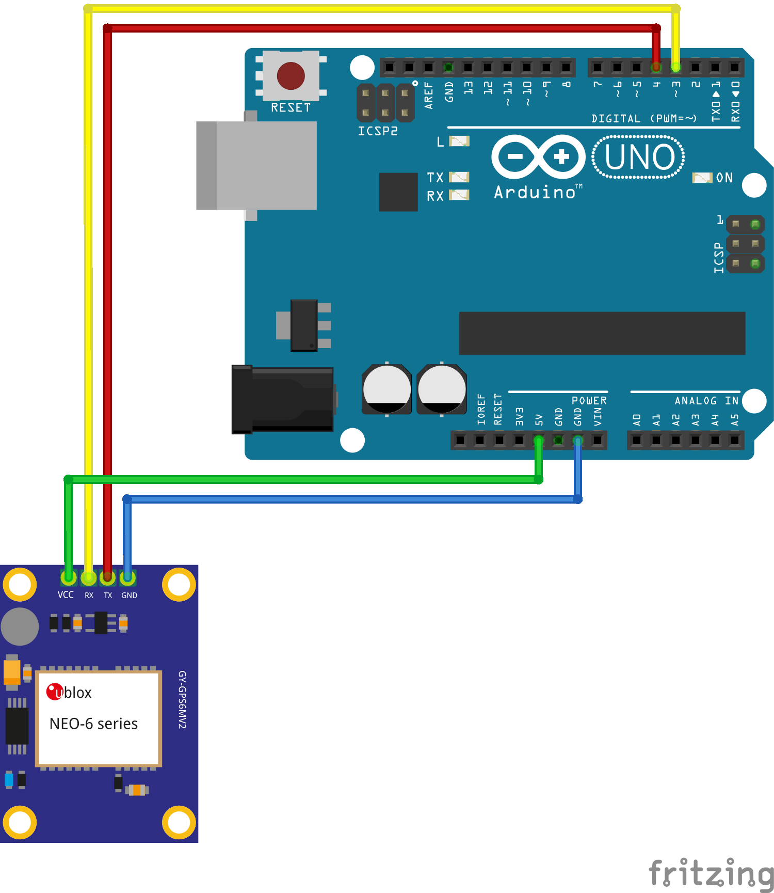

# Bitácora - S02: Prototipado, Pruebas de Hardware y Código GPS

> **Fecha:** 8 de octubre de 2026
> 
> **Autores:** Mártin Palacios Araya, Imay Pizarro Luna

---

## 1. Resumen de la Sesión
Durante esta etapa nos enfocamos en la materialización y primeras pruebas prácticas del prototipo **Piping call**, validando la integración del hardware y la lectura de datos geográficos mediante programación.

## 2. Decisiones de Diseño e Ingeniería de Hardware
* **Selección de componentes:** Se realizó la adquisición de todos los componentes físicos necesarios para el armado del sistema.

  
  
* **Ajuste de placa:** Aunque inicialmente se evaluó el uso de una placa ESP32, debido a la experiencia previa se optó por comenzar utilizando **Arduino UNO** para simplificar las primeras pruebas de conexión.

  
  
* **Conexión y Referentes:** Tomamos como guía principal el tutorial y esquema de *Naylamp Mechatronics* para la integración del módulo **GPS NEO-6M**, utilizando la librería TinyGPS++ para la decodificación de tramas y la comunicación por software serial (SoftwareSerial) en los pines 3 (RX) y 4 (TX).

  

  
## 3. Lógica y Desarrollo del Código
Se estructuró el código principal en Arduino para gestionar la lectura de datos del satélite a través del bucle (`loop`), evaluando variables clave como:
* Validez de la ubicación (`gps.location.isValid()`) para extraer latitud y longitud con 6 decimales.
* Validación de fecha y hora UTC (`gps.date.isValid()` y `gps.time.isValid()`).
* Control de tiempos de espera para advertencias de cableado o falta de señal en caso de superar los 5 segundos sin respuesta.

   

## 4. Pruebas de Terreno y Desafíos
* **Pruebas de visualización:** Se proyectó la integración conceptual de la ubicación en tiempo real mediante una aplicación externa de libre acceso conectada a Google Maps como una idea para aplicar en el futuro del proyecto.
* **Imprevistos climáticos:** Durante las pruebas de terreno experimentamos dificultades debido a las condiciones climáticas (lluvia), lo que afectó la captura de señal de los satélites por parte del módulo GPS y requirió un tiempo de espera prolongado para lograr la fijación de la señal, gracias a este imprevisto lamentablemente no obtuvimos un prototipo funcional par el dia asignado de evaluación.

## 5. Próximos Pasos
* Optimizar la estabilidad de la conexión satelital en distintas condiciones climáticas.
* Avanzar en la integración de las alertas sonoras y el sistema de comunicación bidireccional contemplado en la hipótesis del proyecto.

## Índice de la bitácora

- [Titulo del Proyecto](/README.md)
- [S01 - Entrega 01](/bitacora/S01.md)
- [S03 - Entrega 03](/bitacora/S03.md)
